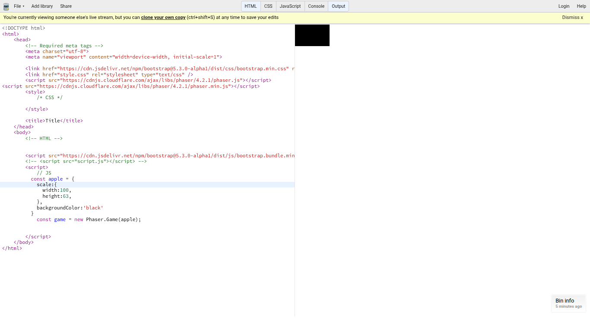

# Entry 1: Deciding on my Freedom Project
##### 11/9/26
## What did I choose and why? 
For the past month, our class had to choose what to do and what tool do we use for our freedom project. For weeks, Mr.Mueller told us to try out different tools and think of a project and tinker with your tool. The tool I choose is Phaser and the project I choose is a game where you can pick a character who is a doctor trying to save a life. You have to get the right supplies in order to help the pacient. There will be monsters from trying to stop you from saving them. If you pick harder, the time limit will decrease and more monsters will come. The reason I choose Phaser was because at first I thought [BabylonJs](https://www.babylonjs.com/) would be a good place to code my game because I heard it was a way to code games but with 3D. I wanted my game to be 2D and Mr.Mueller told me that it would be better if I choose Phaser instead. I also thought that Babylon was a little too hard for me but in order to see which tool is right for me, I had to tinker with both of them. [Here](../tool/learning-log.md) is where I kept all of my learning. Here is the features of both Phaser and Babylon.

[Phaser](https://phaser.io/) is a free place where people can make 2D or 2D games that uses JavaScript and can render graphics. It makes it eaiser to code because it also has built in features. 

Features 
* It has build in physics
* It has scenes where you can connect them together and have more organization 
* It can also make you different things like 
    * Backgrounds 
    * Characters 
    * Music 
    * Textures 
    * Lighting 

While [Babylon](https://www.babylonjs.com/) has a lot of 3D modeling and is mostly used for 3D games. You have to do most of the background and characters on your own using another website. Here are the features 

Features 
* You can add your 3D model 
* You can create 3D shapes
* You have to create all of it
* It also has physics/movement
* It has different types of camera
* It has shaders 

Here is some of the things I did while tinkering. 

In order to create a background to put your characters, you have to actually say your making a game and how you want it to be. Without saying you want to make a game in the code, a background won't show. In order to learn this I used [this video](https://youtu.be/PeQn9CmVIgM?is=IBaJ6hRbsTtz92tq). Here is the code
```js 
const apples67{
    scale:{
        width:#,
        height:#,
    },
    backgroundColor:any color you want,
}
const game = new Phaser.Game(apples67)
```
The `const game = new Phaser.Game(apples67)` is me actually saying I want to make a game and I called it apples67. Then I made `const apples67{}` in order to call it and I used `scale` in order to add height and width. I could also change it to any background color I want. I wanted to make a black background and this is how it turned out.


Another thing I wanted to tinker with is the camera on Babylon. [Here](https://doc.babylonjs.com/journey/theFirstStep) is where I learned the code. Here is the code
```js 
function createScene(){
    //scene
    const scene = new BABYLON.Scene(engine);
    //cam (there are different types)
    const camera1 = new BABYLON.FreeCamera('apple', new BABYLON.Vector3(0,0,0), scene)
    }
```
Whats going on is that in order to make a scene you need to declare that you are making a scene. In order to make a camera where you can move anywhere, you have to type `BABYLON.FreeCamera` which makes a specific camera. I named the camera apple and I put it into the scene. In order to see if this worked, I runned it into the Babylon playground and it worked.

After finishing tinkering, I felt like I liked Phaser more then Babylon because it has more features that are helpful and more physics that I would use. Its also easier to read than Babylon. So I choose Phaser.

## Engineering Design Process
Currently for my Engineering Design Process I am on part "define the problem", because I am still not sure how I am actually going to code it because I need to learn how to create the monsters/characters and actually putting them in the game. I also need to understand how to make everything move when you click up, down,left, or right. I also need to set up a point system and I need to think of what kind of theme I need to put. A problem is that there aren't many games that could be used to to teach kids how to take care of regular medical problems like being sick. So my game will be accurate and have accurate treatments. I will need to do some research on that including the code.


## Skills
One skill i've improved in is growth mindset because while trying to code with Phaser and Babylon, I came into a lot of problems. One example would be actually being able to see the code. Sometimes when I tried to run my phaser code to show up, It would not work. The code was supposed to change the color of the background in order to create a black sky. But instead, it created a white background. I kept checking if the code was right and it was. So it was very frustrating. I decied to give up for the day. The next day I kept trying to figure out was was wrong. I realized that it was not the code that was wrong, it was position. The position of code really matters or else it won't work. 

Another skill I learned is how to learn. This is because some of the things I learned while researching and seeing if I like phaser or babylon is very different to what we learned in SEP. This is because SEP taught us the basics and how to read code while phaser is actually harder code to understand. One example of this is learning how to add new scenes into the game and changing the background. I know this sounds easy but its harder then I thought. This is because we used new words like `mode: Phaser.Scale.FIT` which makes your background fill the users screne and `const camerca = new BABYLON.FreeCamera('apple', new BABYLON.Vector3(0,0,0), scene) ` makes a camera in babylon that follows anywhere you would like. The name I set for that camera is apples and it the camera starts from cordnites (0,0). These  are very new terms that I never seen, but doing my research and tinkering actually taught me how to learn. 

## Next steps
What I am planning to do after this is to learn the code I need to use in order to make the game. For example, how to make a character, add points, make the characters move. I want to come up with more ideas that I could add and learn how to code that to. 

[Next](entry02.md)

[Home](../README.md)