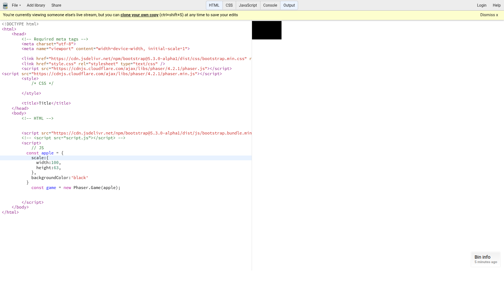

# Tool Learning Log

## Tool: **Babylon**

## Project: **Shrilie party**

---

### 10/24/26:
* Before starting actually coding I was curious what It could actually do [Babylon](https://www.babylonjs.com/)
    * Babylon allows your idea of a video game or scene come to life using 3d and lighing
    * Babylon also allows you to have drawings and change them into 3d 
    * Babylon also has a lot of texture and allows you to change whatever you want with an editor 
* One challenge I had was actually setting everything up because I never used it
    * But in order to fix this I used google to helpe me
* In order to understand, I started with the basics. I used this webstie to help me [First Steps](https://doc.babylonjs.com/journey/theFirstStep) 
    * the first thing i wanted to learn was how to use cameras 
    here is the code I got 
    ```js
  camera = new BABYLON.FreeCamera("camera1", new BABYLON.Vector3(0, 5, -10), scene);
    ```
    * What this is saying is that the cameca is a Free camera where you can move it. the numbers are where you first want to start.
    * `<canvas id="renderCanvas"></canvas>` This renders a starting canvas for your objects. 
    * `const canvas = document.getElementById('renderCanvas')` this renders a canvas and allows it to be read in js 
    ```js
    function createScene(){
    //scene
    const scene = new BABYLON.Scene(engine);
    //cam (there are different types)
    const camerca = new BABYLON.FreeCamera('apple', new BABYLON.Vector3(0,1,0), scene) }

    ```
    * What this code is saying is that it makes a scene work and the camera is created so its free to move but the camera starts from the top. 
    * `'apple'` is the name of the camera were using
    ```js
    const light = new BABYLON.HemisphericLight('light', new BABYLON.Vecotr3(0,1,0), scene)
    ```
    * what this code is saying is that the light is called 'light' and it starts from the top view.
    ```js
    engine.runRenderLoop(() => {
    scene.render();}
    ``` 
    * This actually renders the code so you can see eveything.

    * this is the full code 

```js 
    // canvas
const canvas = document.getElementById('renderCanvas')

// crate a babyLon js engine
const engine = new BABYLON.Engine(canvas,true);

function createScene(){
    //scene
    const scene = new BABYLON.Scene(engine);
    //cam (there are different types)
    const camerca = new BABYLON.FreeCamera('apple', new BABYLON.Vector3(0,0,0), scene) 


    //light
    const light = new BABYLON.HemisphericLight('light', new BABYLON.Vecotr3(0,1,0), scene)

return scene
}

// create our scene
const scene = createScene();


engine.runRenderLoop(() => {
    scene.render();

});


```
* In order to learn all of this I used [this video](https://youtu.be/eQH4273wy7w?is=jNAuGI6tOlqUNR9E). The video was really helpful when starting


### 11/8/26:
* in this learning log, im going to test out phaser. I heard it would be good for my project. maybe i'll like it.
*  in order to start a new game in js you need to type 
```js 
const game = new Phaser.Game();
```
* this allows phaser to set up a background thats ready to launch your game. its the heart of our game. now we can add things. 
* you can change ther color of the size of it
* in order to do that you have to assign any name to the background 
```js
const apples67{
    scale:{
        width:#,
        height:#,
    },
    backgroundColor:any color you want,
}
const game = new Phaser.Game(apples67)

```
* what this code did is that we gave the const a name called apples67
    * then we can give it new properties like the height, color, ect.
* something else we can add is a scaler where it scales down or up the game and your things in the background

```js 
const apples67{
   scale:{
   width:#,
   height:#,
    mode: Phaser.Scale.FIT,
 },
   backgroundColor:any color you want,
  }
const game = new Phaser.Game(apples67)
```

* this keeps our ratio the same as the screen 
    * I tried to make the box very small and i uses width 100 and height 53 this is how it looked



* we can change the type or render we use by changing the type `type: Phaser.CANVAS` or `type: Phaser.WEBGL` 
    * `type: Phaser.AUTO` just picks the best render your laptop can use. 
* `scene,` is used in order to seperate things like a loading screen, a specific scene to connect everything together. 
* you have to make a new file of your scene name and you can put things inside that file. 
    * then you have to apply it back to your game background
    * ex 

    ```js 
    import{loading} from './scenes/loading.js';// this is where were getting our scene from

    const apple67 = { //name of our background 
    type: Phaser.AUTO, // the type of render you want to use
    scene: loading,//the name of the scene your using
    scale: { // the propities of your background and scene
        width: 100,
        height:63,
        mode: Phaser.Scale.FIT, // this allows your scene to fit no matter the size of background
    },
    background.Color:'028af8'  // this is just a blue background
    }

    ```
    * this is an example of a full gamr scene 
        * you can now add your sprites
        * your background you want to use 
* How to render images? (important)
    * this is our scene that we assigned `loading`
    ``` js 
    export class loading extends Phaser.Scene{// this allows the other file to find this scene
        constructor(){
            super({
                key:`loading` // this is now called loading
            })
        }
    }

    ```
    * there are 4 different methods of adding accets 
        * `init()`
        * `preload()`
        * `create()`
        * `update()`
    * there are different ways to load different things 
        * `this.load.image('background, (url)')`
            * background is the key
        * example by using my own words

    ```js
    preload(){
        this.load.image('loading','assets/loading.png')// the loading is the key and the assets/loading.png is out actual image/url 
    }

    ```
    * this allows us to import new things like characters into the scene you want. 


* all of this can be found in [this video](https://youtu.be/PeQn9CmVIgM?is=IBaJ6hRbsTtz92tq)


<!-- 
* Links you used today (websites, videos, etc)
* Things you tried, progress you made, etc
* Challenges, a-ha moments, etc
* Questions you still have
* What you're going to try next
-->
